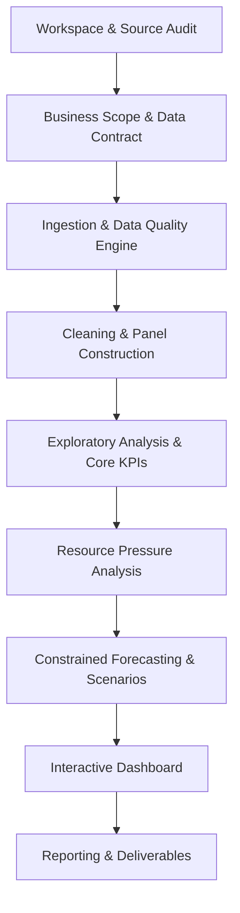

# Project Charter — Smart School Resource Planning

## 1. Executive Summary

The **Smart School Resource Planning** project develops an evidence-based, transparent decision-support system for public school enrollment trends, classroom teacher staffing allocations, and institutional resource pressure across the United States. Utilizing five school years (2018-19 through 2022-23) of National Center for Education Statistics (NCES) Common Core of Data (CCD), the system reconciles school directory attributes, student enrollment headcounts, and teacher full-time equivalent (FTE) staffing into a validated longitudinal panel.

The platform provides educational policy makers, state departments of education, and district administrators with reliable indicators to identify structural resource mismatches, distinguish genuine operational growth from reporting artifacts, and project short-term aggregate staffing needs.

---

## 2. Problem Statement

Educational leaders face complex challenges in optimizing classroom resources:
1. **Dynamic Demographic Shifts:** Rapid demographic changes, migration patterns, and post-COVID-19 enrollment reallocations create localized surges and contractions in student enrollment.
2. **Staffing Mismatches:** Staffing adjustments frequently lag enrollment changes due to tenure cycles, hiring freezes, and geographic labor market constraints, resulting in elevated student-to-teacher ratios or underutilized capacity.
3. **Data Fragmentation and Quality Obstacles:** Federal administrative extracts often suffer from subtle definition shifts, missingness (e.g., non-reported FTE), and structural anomalies (e.g., adult education counts bundled with PK-12 regular schooling, specialized instructional configurations, zero-teacher administrative units).
4. **Misinterpretation of High-Level Ratios:** High-level student-to-teacher FTE ratios are frequently conflated with classroom class sizes, leading to misguided policy decisions.

---

## 3. Project Objectives

1. **Longitudinal Analytical Panel:** Construct a unified, reproducible school-year panel spanning 2018-19 to 2022-23 at the primary grain of one record per school (`school_id` / `NCESSCH`) per `school_year`.
2. **Standardized KPI Framework:** Establish rigorous mathematical formulas, units, eligibility rules, and explicit caveat disclosures for core operational indicators (Enrollment, Teacher FTE, Student-to-Teacher Ratio, YoY Growth Rates, Ratio Growth Rate, and the Enrollment-Staffing Growth Gap).
3. **Resource Pressure Profiling:** Implement a transparent, hierarchical classification system (Priority 1: Incomplete Data or Status Review, Priority 2: High Current Ratio, Priority 3: Rapidly Rising Ratio, Priority 4: Staffing Growth Deficit, Priority 5: Growth Unassessed / Incomplete Growth Data, Priority 6: Stable / Balanced) that prioritizes data quality and administrative status reviews before evaluating pressure.
4. **Constrained Forecasting & Scenarios:** Implement statistically defensible state-level aggregate retrospective benchmark projections (Naive Persistence, Drift, Moving Average) with historical walk-forward backtesting (2021-22 and 2022-23), while explicitly noting that 2023-24 forecast accuracy cannot be evaluated in this workspace and rejecting school-level modeling due to short time-series constraints (T=5).
5. **Interactive Decision Dashboard:** Deliver a modern, interactive Streamlit application enabling multi-level filtering (state, agency, school type, operational status) and transparent drill-downs from national aggregates down to individual school profiles.

---

## 4. Project Scope

### In-Scope
* **Time Span:** Five complete school years: 2018-19, 2019-20, 2020-21, 2021-22, 2022-23.
* **Data Sources:** Three NCES CCD Non-Fiscal School-Level Components:
  - Directory (`029`)
  - Membership / Enrollment (`052`)
  - Staff / Teacher FTE (`059`)
* **Geographic Coverage:** All 50 U.S. states, the District of Columbia, Bureau of Indian Education (BIE), and U.S. Outlying Areas / Territories present in NCES CCD releases.
* **School Entities:** Operational public elementary and secondary schools present in Directory (`029`), including regular public, charter (`CHARTER_TEXT`), vocational, and special education schools (`SCH_TYPE_TEXT`).
* **Forecast Grain:** State-level macro aggregates (with scenario bounds) evaluated via walk-forward cross-validation.

### Out-of-Scope
* **Individual PII:** No student-level, teacher-level, or personally identifiable information.
* **Fiscal & Financial Records:** Teacher salaries, per-pupil expenditures, and facility maintenance budgets (not captured in school-level CCD files 029, 052, 059).
* **Physical Facilities:** Classroom square footage, building capacity, and HVAC infrastructure.
* **Causal Impact Analysis:** Estimating causal treatment effects of policy interventions.
* **Automated School-Level Machine Learning:** Arbitrary multi-year predictive modeling on individual school facilities with only 5 annual data points.
* **Virtual School & Geographic Locale Disaggregation:** The ingested 029, 052, and 059 components do not provide verified virtual school identifiers or urban-centric locale codes. While schools operating virtually are part of the overall reporting universe, they cannot be reliably identified or separately segmented without a documented external enrichment source (such as dedicated NCES EDGE locale and school boundary files).

---

## 5. Stakeholders & Target Audience

| Stakeholder Role | Primary Decision / Use Case | Required Information |
| :--- | :--- | :--- |
| **State Education Agency (SEA) Planners** | Statewide allocation monitoring, identifying districts facing acute teacher recruitment deficits. | State/district aggregate trends, YoY growth gaps, data reporting completeness. |
| **District (LEA) Superintendents & Administrators** | School-level staffing adjustments, boundary planning, hiring prioritization. | School-level student-teacher ratios, 5-year longitudinal trend profiles, cohort comparison. |
| **Education Policy Analysts & Researchers** | Assessing systemic staffing trends pre- and post-COVID-19 across geographic and institutional types. | Cleaned, validated panel data, transparent data quality audit logs, reproducible codebase. |
| **School Principals & Resource Coordinators** | Benchmarking facility staffing ratios against district and state medians. | Peer school comparisons, historical enrollment trajectory, cohort stability flags. |

---

## 6. Deliverables and Milestone Roadmap

* **Workspace & Source Audit:** Source audit, verification of 15 raw CSV files, directory layout documentation.
* **Business Scope & Data Contract:** Business requirements, data contracts, configuration schemas, forecasting feasibility boundary.
* **Ingestion & Data Quality Engine:** Robust file readers, schema normalizer, key check engine, comprehensive data quality profiling.
* **Cleaning & Panel Construction:** Deterministic ID cleaning, indicator filtering, multi-source joins, validated Parquet analytical panel.
* **Exploratory Analysis & Core KPIs:** Distribution profiling, descriptive summaries, KPI compute engine.
* **Resource Pressure Analysis:** Resource pressure categorization rules, growth gap indexing, anomaly identification.
* **Constrained Forecasting & Scenarios:** State-level walk-forward benchmark models, error quantification (MAE/WAPE), scenario planning.
* **Interactive Dashboard:** Streamlit interactive application.
* **Reporting & Deliverables:** Technical report, executive brief, runbook, and reproducible pipeline orchestration.

---

## 7. Success Criteria & Quality Gates

1. **Data Integrity & Traceability:** Zero silent loss of records or leading zeroes in identifiers (`NCESSCH`, `LEAID`, `FIPST`). 100% auditability from raw CSV inputs to final analytical panel.
2. **Defensible KPI Calculations:** Strict adherence to data contracts: non-reported teacher data is never treated as zero; ratios with zero denominators yield explicit nulls with diagnostic flags; growth rates require continuous common-school cohorts.
3. **Honest Analytical Framing:** Explicit labeling on every visual and table stating that student-to-teacher ratio is a staffing allocation measure, NOT average class size.
4. **Reproducibility & Engineering Standards:** Deterministic execution via `uv` package manager, 100% test pass rate across unit and integration suites, strict linting compliance via `ruff`.
