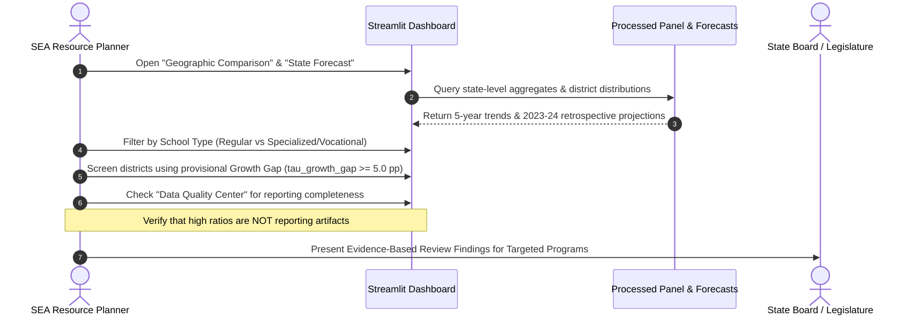
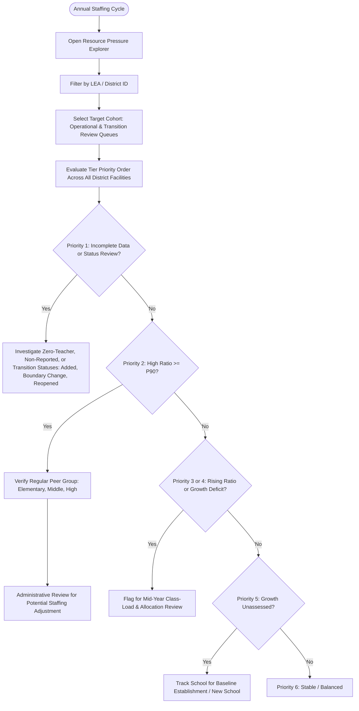

# Stakeholder Workflows & Decision-Support Playbook

## 1. Overview

The **Smart School Resource Planning** system serves diverse administrative personas across federal, state, and local educational ecosystems. Because administrative decisions carry significant financial and operational consequences, stakeholders must interact with data outputs through structured, defensible workflows that safeguard against common data misinterpretations.

The platform is designed strictly as a **decision-support tool**, not an automated resource-allocation engine. All indicator flags, percentile comparisons, and resource-pressure tiers serve to prioritize facilities for informed administrative review rather than dictating automatic funding or staffing actions.

This playbook establishes the standard operating workflows for four core stakeholder roles.

---

## 2. Stakeholder Persona Matrix

| Role | Operational Scope | Primary Decisions | Key Dashboard Views |
| :--- | :--- | :--- | :--- |
| **State Education Agency (SEA) Planner** | Statewide macro-allocations, cross-district equity, teacher supply trends. | Prioritizing districts for administrative review of targeted recruitment grants, emergency staffing technical assistance. | `Geographic Comparison`, `State Forecast & Scenario Planner`, `Data Quality` |
| **District (LEA) Superintendent / HR Director** | Intra-district school staffing allocations, boundary rebalancing, collective bargaining preparation. | Evaluating administrative staffing requests, assessing teacher allocation needs, investigating reporting anomalies. | `Resource Pressure Explorer`, `Overview`, `Data Quality` |
| **Education Policy Research Analyst** | Longitudinal trend analysis, legislative testimony, structural equity studies. | Publishing policy briefs, assessing impact of statutory ratio caps, evaluating post-COVID recovery patterns. | `Analytical Panel Exports`, `Quality Audit Reports`, `Overview` |
| **School Principal / Campus Administrator** | School facility staffing management, master schedule development. | Compiling contextual evidence to support administrative staffing requests to LEA leadership. | `Resource Pressure Explorer (School Profile)`, `Overview` |

---

## 3. Detailed Operational Workflows

### Workflow 1: State Education Agency (SEA) — Annual Staffing Allocation & Equity Review

1. **Trigger:** Annual state legislative budget preparation or mid-year staffing allocation review.
2. **Step 1: Statewide Macro Review & Retrospective Projections:**
   - Navigate to `State Forecast & Scenario Planner`.
   - Review 5-year aggregate trend in `total_students` and `teacher_fte` (covering historical years `2018-19` through `2022-23`).
   - Inspect the **2023-24 retrospective projection benchmark** under the Linear Drift and 3-Year Moving Average models. *(Note: Because ground-truth 2023-24 data is not part of this 5-year workspace, this projection serves as a retrospective scenario benchmark; empirical forecasting accuracy is evaluated via walk-forward backtests on 2021-22 and 2022-23).*
   - Evaluate illustrative +/- 1% and +/- 2% scenario boundaries to contextualize macro teacher supply dynamics across the state.
3. **Step 2: Cross-District Equity Disparity Scan:**
   - Navigate to `Geographic Comparison`.
   - Inspect descriptive district-level median `student_teacher_ratio` values and aggregate `growth_gap_pct_points`. *(Note: District medians represent descriptive comparative metrics across comparable regular cohorts, not official statutory staffing-adequacy standards).*
   - Screen for districts where enrollment expanded over consecutive reporting periods while teacher FTE contracted or remained flat, evaluating against provisional candidate parameters (such as `tau_growth_gap >= 5.0 percentage points`, pending Phase 5 empirical stakeholder calibration).
4. **Step 3: Data Quality Verification:**
   - Switch to `Data Quality & Coverage Center`.
   - Verify the target district's `teacher_data_flag` reporting completeness and `teacher_missingness_rate`. Where missingness is elevated (e.g., exceeding an illustrative operational monitoring threshold such as 10%, subject to administrative definition), route records to the district accountability officer for data verification prior to resource deliberations.
5. **Outcome:** An evidence-based, prioritized list of districts identified for administrative review to evaluate eligibility for targeted recruitment initiatives, retention stipends, or technical assistance—not an automatic funding entitlement.

---

### Workflow 2: District Administrator (LEA) — School-Level Resource Pressure & Staffing Authorization

1. **Trigger:** Spring staffing planning for the upcoming academic year.
2. **Step 1: District Facility Cohort Selection:**
   - Open `Resource Pressure Explorer`.
   - Filter by District Name / `LEAID`.
   - Select the target analytical cohort view: administrators can select the active operational cohort (`Open`, `New`) for core operational KPI benchmarking, while ensuring transition-review records (`Added`, `Changed Boundary/Agency`, `Reopened`) remain fully visible in the review queue and data quality audit outputs. In accordance with `config/project.yaml` and `config/quality_rules.yaml`, operational status scoping is applied as an analytical cohort flag rather than silently dropping records at ingestion; transition-review records must not be silently excluded before they reach status review, nor automatically presumed inactive, but are routed to Priority 1 for explicit empirical verification against reported enrollment and staffing data.
3. **Step 2: Hierarchical Triage by Pressure Tier:**
   - **Check Priority 1 (Incomplete Data or Status Review) First:** Review facilities routed to Priority 1 before evaluating ratio thresholds. This queue captures:
     - Facilities flagged with `zero_teacher_anomaly` (`TEACHERS == 0.0` but `DMS_FLAG == 'Reported'`) or non-reported staff data (`DMS_FLAG != 'Reported'`).
     - Incomplete data records (missing enrollment or uncomputable ratio).
     - Transition-review facilities (`Added`, `Changed Boundary/Agency`, `Reopened`) preserved in the review queue to evaluate structural boundary shifts, organizational additions, or agency changes before any routine KPI evaluation.
     Contact principals or LEA data stewards to verify facility operations and staffing models before taking downstream allocation actions.
   - **Evaluate Priority 2 (High Current Ratio):** Isolate regular schools with `student_teacher_ratio >= P90` for their instructional level (`Elementary`, `Middle`, `High`). Schools in unbenchmarked peer groups (specialized school types or non-standard levels) bypass Priority 2 to prevent invalid cross-model comparisons.
   - **Evaluate Priority 3 & 4 (Rapidly Rising Ratio & Staffing Growth Deficit):** Review schools where student intake significantly outpaced teacher hiring over consecutive reporting years. Both `tau_ratio_rise` (+15.0% YoY ratio increase) and `tau_growth_gap` (+5.0 percentage points) are explicitly provisional candidate parameters for decision-support prototyping, pending Phase 5 calibration with stakeholders.
   - **Acknowledge Priority 5 (Growth Unassessed / Incomplete Growth Data):** Note base-year schools (2018-19), newly opened schools, or schools where prior-year data gaps prevented growth calculations. Explicitly avoid treating unassessed facilities as stable.
   - **Review Priority 6 (Stable / Balanced):** Operational facilities with assessed, stable allocations. *(Critical Interpretation Caveat: For schools with `peer_group_status == 'Unbenchmarked / Specialized Peer Group'`, assignment to Stable / Balanced denotes solely that available longitudinal trend indicators did not cross provisional escalation thresholds. It does NOT imply or certify that the school's absolute staffing levels or student-to-teacher ratio have been shown to be adequate, balanced, or compliant with programmatic guidelines).*
4. **Step 3: Institutional Context Verification (Verified Attributes):**
   - Disaggregate by verified school types in directory (`SCH_TYPE_TEXT`: Regular School, Special Education School, Career and Technical School, Alternative School) and charter status (`CHARTER_TEXT`).
   - *Special Education / Career & Technical / Alternative Schools:* Specialized instructional models operate under distinct staffing structures and IEP mandates. Because NCES CCD provides no authoritative statutory ratio standards or peer-group distributions for specialized models, their ratios must never be evaluated against regular school P90 benchmarks or arbitrary invented numerical targets. Any review of staffing in specialized programs requires qualitative administrative assessment and programmatic context.
   - *Data Limitation Note:* Virtual school indicators and urban-centric locale codes are **not available** in the ingested 029, 052, 059 components. They are documented as potential future enrichments requiring external sources (e.g., NCES EDGE data).
5. **Outcome:** A prioritized, board-ready agenda for administrative review: evaluating facility-level needs to determine whether targeted staffing adjustments, floating teacher support, or boundary rebalancing are warranted for validated Priority 2/3/4 schools, while initiating data reconciliation for Priority 1 schools. Resource allocations require local administrative determination and are never automatic consequences of tier assignment.

---

### Workflow 3: Policy Analyst — Post-Pandemic Staffing Recovery Study

1. **Trigger:** Independent research initiative or legislative committee briefing on public school resilience.
2. **Step 1: Cohort Extraction:**
   - Ingest `data/processed/panels/school_year_analytical_panel.parquet`.
   - Filter for common-school balanced panel: schools with valid operational records across all 5 school years (`2018-19` through `2022-23`).
3. **Step 2: Disaggregation by School Type and Sector:**
   - Segment schools by verified directory attributes: regular public vs. charter (`CHARTER_TEXT`) and school level (`LEVEL`: `Elementary`, `Middle`, `High`).
   - *Limitation Note:* Geographic locale disaggregation (Urban, Suburban, Rural) is not present in the selected CCD extracts and is documented as a candidate future enrichment requiring external NCES EDGE locale files.
4. **Step 3: COVID-19 Shock Analysis:**
   - Benchmark enrollment and teacher FTE drops in `2020-21` (pandemic shock year) against baseline `2018-19` / `2019-20`.
   - Track recovery slope across `2021-22` and `2022-23`.
5. **Step 4: Robustness & Caveat Integration:**
   - Formulate conclusions distinguishing enrollment decline from teacher shortages.
   - Enforce explicit disclaimers: ratios represent aggregated facility resources, not classroom class sizes.
6. **Outcome:** Defensible, peer-reviewable policy brief with full reproducibility metadata and clear audit trails.

---

### Workflow 4: School Principal — Campus Staffing Justification

1. **Trigger:** Annual campus budget submission or enrollment surge following local residential construction.
2. **Step 1: Campus Profile Benchmarking:**
   - Open `Resource Pressure Explorer` and look up campus by `NCESSCH` or School Name.
   - Compare campus `student_teacher_ratio` against the descriptive district median and state median for the same instructional level (`Elementary`, `Middle`, `High`).
   - *Descriptive Context Rule:* State and district medians are descriptive reference points for comparable regular cohorts, not statutory staffing standards. Comparisons must explicitly account for campus instructional model, grade span, and special program offerings.
3. **Step 2: Trend Substantiation:**
   - Document campus 5-year trend in enrollment versus staffing.
   - Review multi-year `growth_gap_pct_points` demonstrating whether student intake has outpaced teacher hires over consecutive reporting years.
4. **Step 3: Formal Administrative Request Submission:**
   - Export campus KPI summary card from dashboard.
   - Submit formal justification packet to LEA superintendent citing verified NCES indicators and comparable cohort descriptive medians as contextual evidence to support administrative staffing review.

---

## 4. Analytical Safeguards and Prohibited Uses

To preserve ethical integrity and prevent misallocation of public funds, the following operating rules are mandatory:

1. **PROHIBITION 1: Class Size Equivalence:**
   - Stakeholders shall NOT cite the `student_teacher_ratio` as "average class size." Classroom class sizes depend on master schedule period configurations, co-teaching models, preparation periods, and specialized pull-out programs.
2. **PROHIBITION 2: Unverified Zero-Teacher Reallocations:**
   - Stakeholders shall NOT conclude a school has zero teachers without investigating whether the facility is an administrative parent center, vocational shared campus, or reporting entity whose instructional staff are reported at the LEA level.
3. **PROHIBITION 3: Blind Ratio Cuts in Special Education / Alternative Facilities:**
   - Ratios in specialized institutions must never be judged against regular elementary/secondary deciles or arbitrary invented standards without disaggregating by school type and conducting qualitative programmatic reviews.
4. **PROHIBITION 4: Automated Resource Allocation Without Administrative Review:**
   - Resource pressure tiers, growth gaps, and P90 percentile flags shall NOT be used as automatic triggers for staffing cuts, mandatory FTE reallocations, or state subsidy awards. All outputs are advisory decision-support indicators requiring local administrative evaluation.
